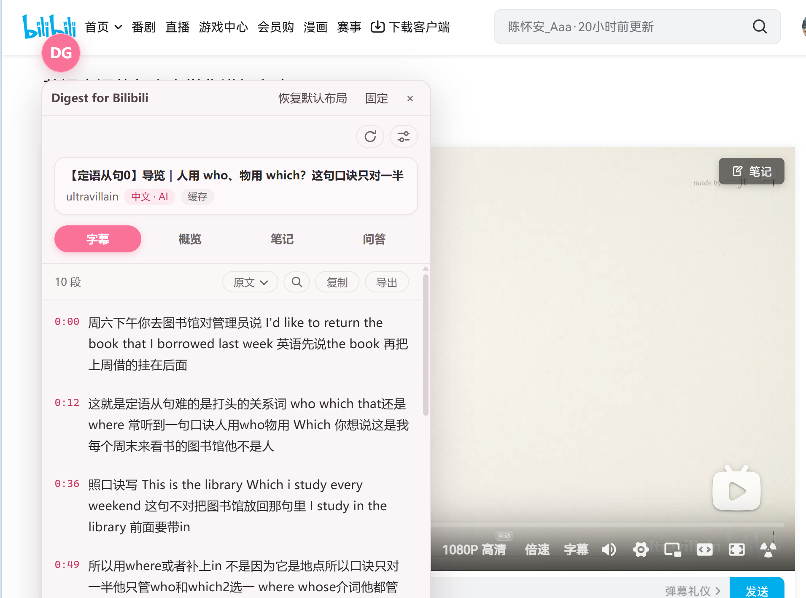
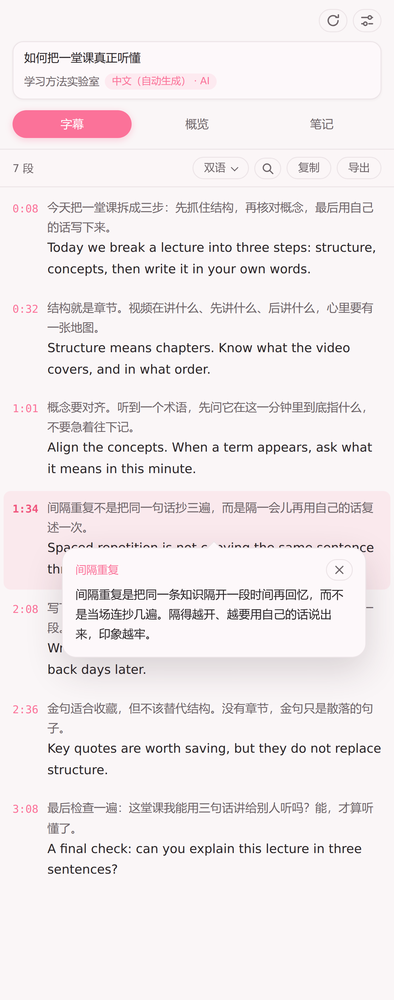
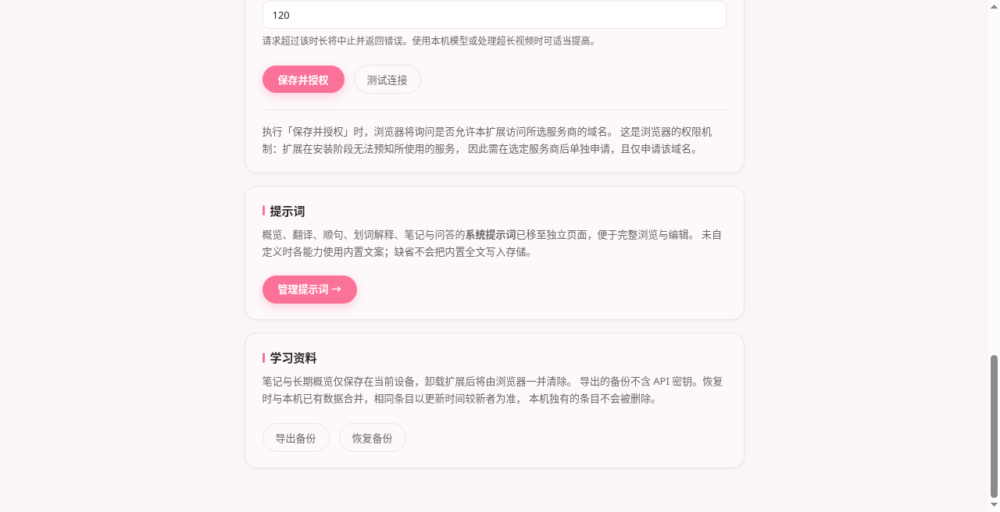
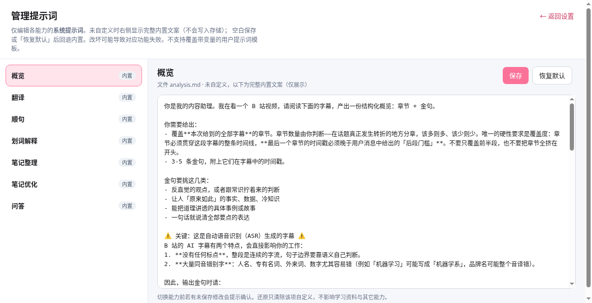
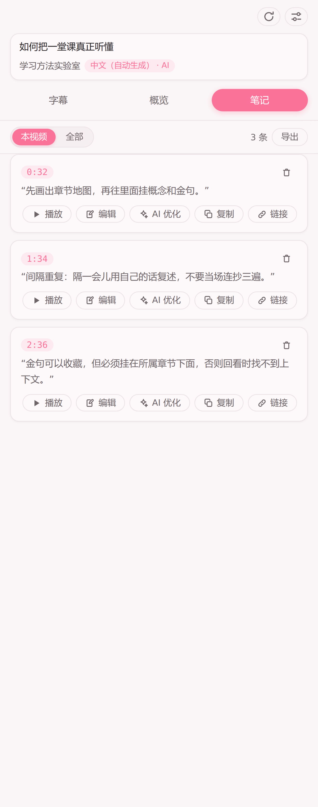
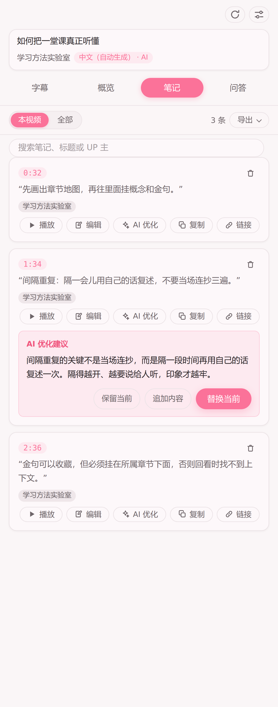
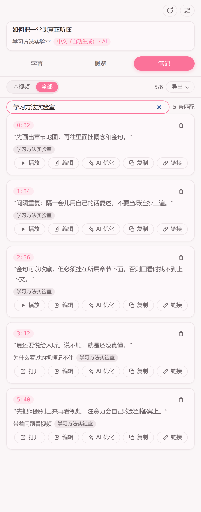
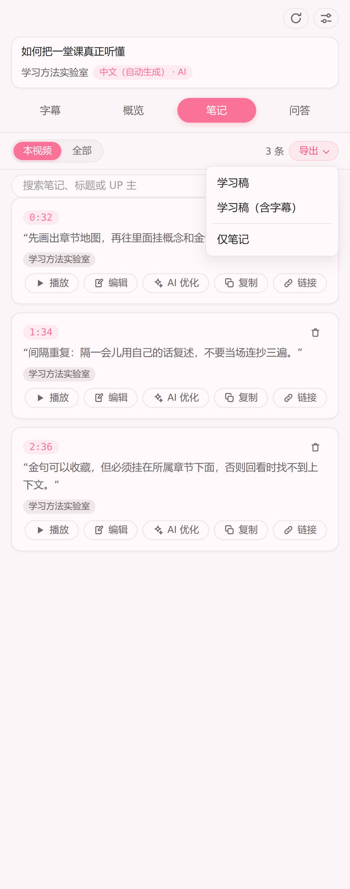

# Digest for Bilibili

本项目是Digest for Bilibili的改版，主要修改内容：

本次修改将插件原来的 **Chrome 原生侧边栏改为 B 站网页内的悬浮面板**，保留原有字幕、概览、问答、笔记等功能，并优化了使用体验：

- **仅在 B 站显示**：各 B 站标签页自动加载对应视频的字幕；切到其他网站不显示，切回 B 站自动恢复。
- **悬停展开、移出收起**：启用后显示 DG 悬浮按钮，鼠标移入展开详情，移出自动收起；点击「固定」可保持展开。
- **自由调整布局**：支持拖动悬浮按钮或标题栏移动位置，通过面板四边、四角调整大小。
- **布局持久保存与同步**：位置、大小、悬浮按钮位置和固定状态自动保存，刷新页面、重启浏览器后恢复，并同步到其他 B 站标签页。
- **一键恢复默认布局**：恢复默认大小与位置、取消固定，并同步其他标签页。
- **尊重手动关闭**：关闭后不会因刷新或切换页面再次弹出，需主动点击插件重新打开。

界面展示

**以下为原项目简介**

---

把 B 站视频变成学习资源：在播放页旁边打开侧边栏，阅读字幕、对照双语、生成章节概览、划词解释，并记下带时间戳的笔记。

**B 站网页端的 [youtube-digest](https://github.com/zarazhangrui/youtube-digest) 复刻项目**，架构蓝本与提示词起点来自上游仓库（MIT）。

## 本地页内侧栏版

本地修改版将侧栏嵌入 B 站页面，复用原有字幕、概览、问答、笔记和设置界面。面板以可移动悬浮层显示，不改动播放器 DOM。

- 点击视频页 Digest 按钮或浏览器扩展图标打开；所有 B 站标签页共用打开状态，各自加载宿主视频的字幕。
- 切到外站自然不可见，返回 B 站保留面板；刷新或新开 B 站页面也恢复已保存的打开状态。
- 点击悬浮面板顶部「×」会关闭所有 B 站页面中的面板，并持久保存；再次主动打开前不会自动弹出。
- 启用后默认显示 DG 悬浮按钮，鼠标移入展开，离开按钮和面板后自动收起；收起保留内容和任务。
- 点击「固定」后保持展开，点击「已固定」恢复自动收起。拖动按钮或面板标题栏移动，拖动四边或四角缩放；窗口变小时自动限制在可见范围。位置、尺寸、悬浮按钮位置和固定状态会自动保存在扩展本地存储，并同步所有 B 站标签页；刷新或重启浏览器后恢复。不同窗口仅按各自可见范围调整显示，不会因窗口较小而覆盖已保存的布局。
- 点击标题栏「恢复默认布局」，重置面板为 440 × 620、默认右侧位置和未固定状态，同时重置悬浮按钮位置，并保存、同步到其他 B 站标签页。小窗口会自动限制显示范围；不会改变已关闭状态。
- 扩展重新加载后，请刷新已打开的 B 站页面以更新内容脚本。原有设置和学习资料不需要重新配置。

---

## 安装（Chrome 与 Edge 商店）

同一份代码、同一个安装包，两边功能没有差别。需要 116 及以上的版本。

| 商店 | 上线日期 | 安装链接 |
| --- | --- | --- |
| Chrome Web Store | 2026-08-15 | [安装 Digest for Bilibili](https://chromewebstore.google.com/detail/digest-for-bilibili/cfndfabkpfgihcgknbgfnkjlmndhhmfc) |
| Microsoft Edge Add-ons | 2026-08-17 | [安装 Digest for Bilibili](https://microsoftedge.microsoft.com/addons/detail/digest-for-bilibili/jlfmjhkcbnkgghefieaagkcccjojmnkm) |

商店索引可能稍晚更新，直达链接可正常使用。

---

## 字幕

字幕取自 B 站官方接口，不经第三方服务。

- 原文 / 译文 / 双语三种视图；中文译英、外文译中，方向按字幕轨语种自动选择
- 默认先用人工字幕。只有机翻中文、另有人工外文轨时用人工外文；UP 主只上传了一种语言时用那种语言。中英都有人工字幕时仍先用中文
- 同一字幕文件只留更具体的语言名。文件不同的「中文（中国）」会保留：播放器单独列出它，未登录时往往只有它有正文
- 顺句：为 AI 字幕补标点、改同音错别字，不改措辞、不动时间轴
- 顺句与翻译显示批次进度，可随时停止；已完成内容保留
- 当前句跟随播放高亮，点一句跳到对应时间；跟丢了有「回到当前句」
- 全文搜索（快捷键 `/`）、复制、导出 TXT

## 概览

AI 通读字幕，产出带时间戳的章节，金句按时间挂在所属章节之下。点章节或金句即可跳转。

长视频按分段切块并发生成，块与块之间携带重叠上下文；部分失败不影响已完成的部分，概览里可单独补失败块。生成期间可停止，完成后可重新生成。分块长度与重叠字数在设置页调整。

## 划词解释

选中字幕里的术语或概念，点「解释」。AI 结合前后文用大白话说明，浮层贴在选中文字旁边。

## 笔记

播放时点播放器上的「笔记」或按 `n`，记下当前时间点。AI 把当时那句字幕整理成通顺一句话。页内小窗出现时，这个按钮会让开，避免挡住小窗的关闭按钮。

卡片可编辑、回放、复制和跳转。手动改过正文后，可让 AI 给出优化建议，预览后再选择保留、替换或追加。优化可以停止，取消不改写正文。

笔记按视频与分 P 保存；可只看当前分 P，或翻全部历史。卡片上会标出 UP 主，翻全部时还会带视频标题。当前列表可导出为带时间戳链接的 Markdown，范围跟「本视频 / 全部」一致，也可按正文、标题或 UP 主搜索。概览或本视频笔记里还可以导出学习稿：YAML 头、章节、金句、笔记，可选附带当前视图的字幕。

设置页可导出或恢复 JSON 备份（不含 API 密钥）；外观上可选主题色板、明暗模式、文字浓度与界面字号，即改即生效，播放页上的扩展按钮也会跟随主题色。概览、翻译、顺句、划词解释、笔记与问答的系统提示词可在「管理提示词」独立页查看与自定义。

## 问答

针对当前视频自由提问。AI 先在字幕里检索相关内容再组织回答，关键结论都带时间戳引用，点一下就跳回视频对应位置；引用必须是字幕原文，字幕里没有依据时如实回答「未找到」，不编造。

长视频只把检索命中的片段送给模型，省额度也更快；生成中可以随时停止。问答历史按视频保存，回答可一键复制。笔记和这些资料现在都存进浏览器的 IndexedDB，容量不再受旧存储的上限约束，升级自动迁移。

## 本地 Ollama

选择「本地 Ollama」后，测试连接若出现 403，是 Ollama 拒绝了扩展页面的来源，与 API 密钥无关。默认安装只接受本机页面，不接受 `chrome-extension://`。拉取模型列表可能成功，但对话和测试连接仍需设置 `OLLAMA_ORIGINS`。

启动 Ollama 前设置环境变量 `OLLAMA_ORIGINS=chrome-extension://*`，然后完全退出并重新启动 Ollama（只改变量、不重启不会生效）。

- macOS：终端执行 `launchctl setenv OLLAMA_ORIGINS "chrome-extension://*"`，再从菜单栏退出 Ollama 并重新打开
- Windows：在系统环境变量中新增 `OLLAMA_ORIGINS`，值为 `chrome-extension://*`，然后从托盘退出 Ollama 再打开
- Linux：启动前 `export OLLAMA_ORIGINS=chrome-extension://*`，或在 systemd 服务里加上 `Environment=OLLAMA_ORIGINS=chrome-extension://*` 后重启服务

## 本地加载

商店安装见顶部 [安装](#store-install)。

跑 `npm run package` 得到 `dist/` 下的 zip，解压后打开扩展管理页（`chrome://extensions` 或 `edge://extensions`），开启开发者模式，加载解压目录。

装好后会打开设置页。字幕阅读开箱即用；顺句、翻译、概览、划词解释、笔记整理和问答需要先填模型服务地址和密钥。

商店审核底稿见 [STORE-LISTING.md](STORE-LISTING.md)。

## 许可与致谢

[MIT](LICENSE)。源自 [youtube-digest](https://github.com/zarazhangrui/youtube-digest)（MIT，Copyright (c) Zara Zhang），架构蓝本与部分提示词模板来自该仓库。出处见 LICENSE 与 `prompts/` 各文件头部。
